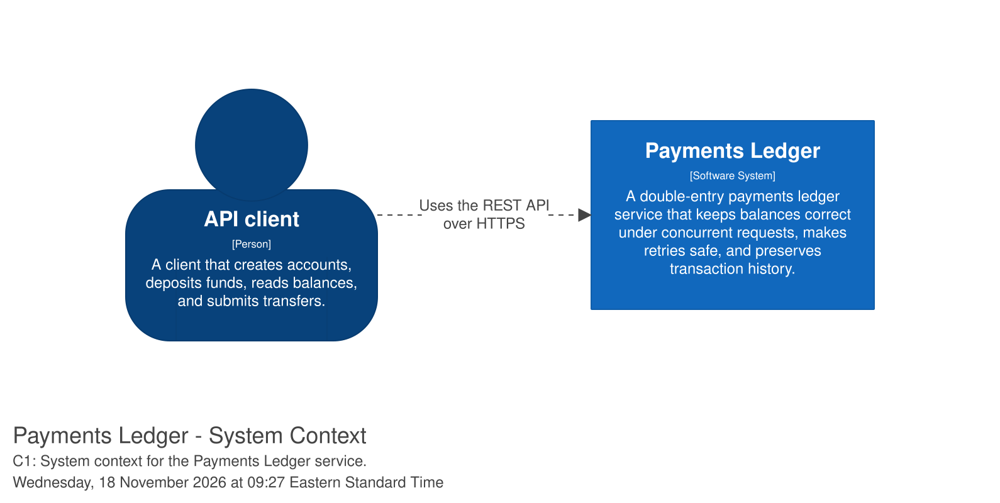

# Payments Ledger

## Overview

Payments Ledger is a backend service for moving money between accounts safely.
Its goal is to prevent money from being created or lost when several requests
arrive at once or the same transfer is submitted twice.

For example, an account may start with $100. If two $80 withdrawals arrive
simultaneously, only the valid withdrawal should succeed. The system must prevent
the account from becoming overdrawn and must produce one balanced transaction
history.

This project is intentionally focused on backend correctness. It uses
integer-cent amounts and double-entry accounting: every completed transfer
creates one debit and one credit, so the ledger remains balanced.

## Technical Details

- Account creation, deposits, and balance reads
- Double-entry transfers with integer-cent amounts
- Database-enforced amount, account, and append-only ledger constraints
- Idempotency-key replay and payload-conflict handling for transfers
- Row locking and bounded retries for concurrent money movement
- Immutable transfer reversals represented by compensating entries
- Reconciliation drift checks through Solid Queue
- Hashed API-key authentication
- Cursor pagination for ledger entries and transfers
- Request, service, database, and PostgreSQL concurrency tests
- GitHub Actions checks for RSpec, RuboCop, Brakeman, and Bundler Audit

## Architecture

The API-only Rails application validates requests and executes money-movement
commands. PostgreSQL owns transactional state and enforces invariants. API-key
authentication, reconciliation, and background processing use Rails and
PostgreSQL-native components.

### C1: System context

### C2: Container view

The architecture is also maintained as Structurizr DSL in
[`architecture/workspace.dsl`](architecture/workspace.dsl), including the C1
system-context and C2 container views.

## Limitations

Payments Ledger intentionally does not implement account-level authorization,
rate limiting, audit logging, structured telemetry, or deployment automation.
These are scope boundaries rather than claims that the prototype is ready for
production payment traffic.

Future work includes webhooks, holds and authorizations, audit logging,
structured operational telemetry, and production deployment with measured load
testing.

For API endpoints, data models, testing, and implementation decisions, see
[TECHNICAL_OVERVIEW.md](TECHNICAL_OVERVIEW.md).
