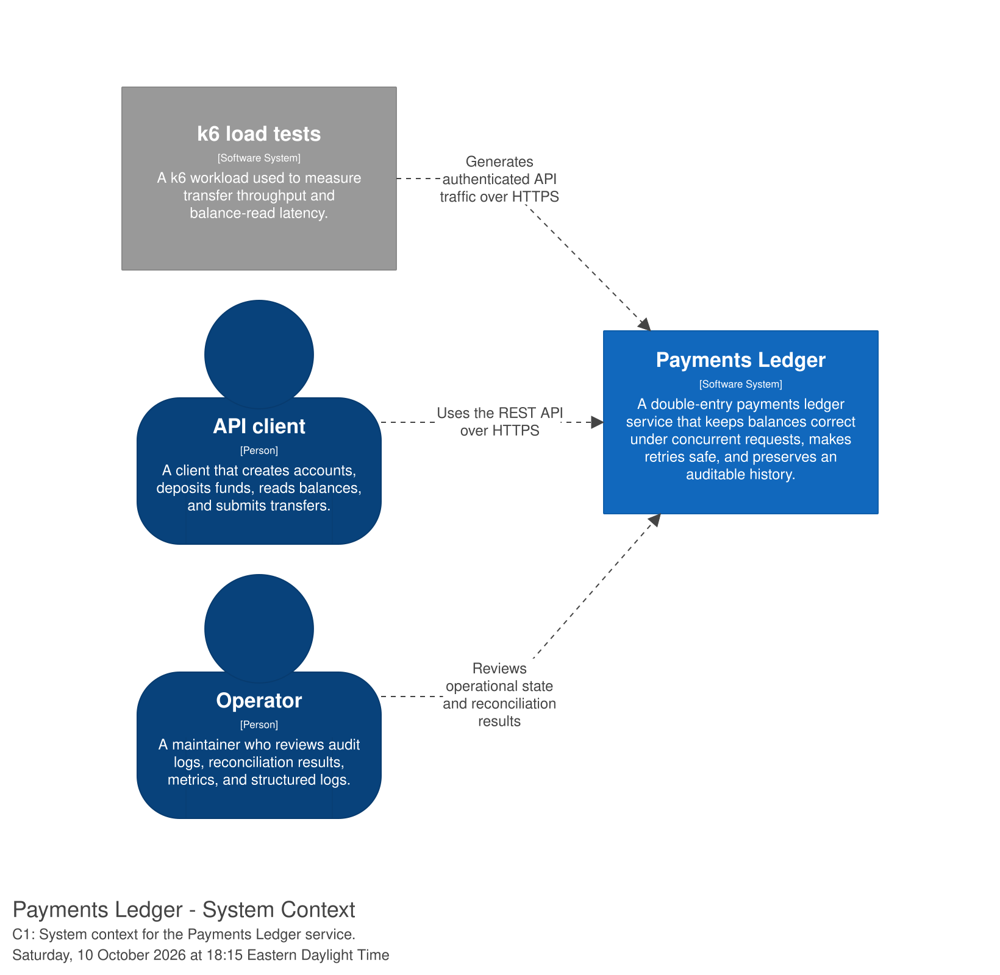
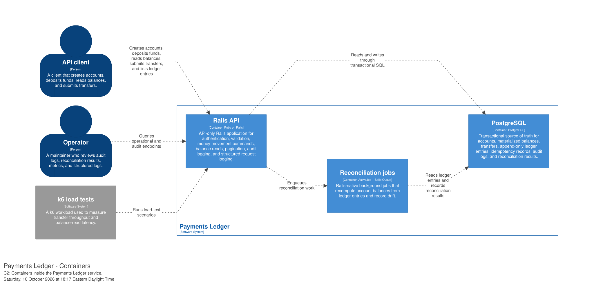

# Payments Ledger

Payments Ledger is a planned double-entry payments ledger service designed to make
every cent traceable, transfers safe to retry, and balances correct under
concurrent requests.

The project focuses on backend correctness rather than CRUD breadth. PostgreSQL
will be the source of truth for accounts, transfers, ledger entries, and
balances. The central invariant is that a committed transfer has equal debit and
credit entries, so the ledger always sums to zero.

This is a personal project and is not connected to any employer or production
payment system.

## Scope

The planned service will support:

- Account creation, deposits, and balance reads
- Double-entry transfers between accounts
- Integer-cent money amounts with an explicit currency
- Insufficient-funds rejection
- Database-enforced integrity constraints
- Safe retries through idempotency keys
- Concurrency control for withdrawals and transfers
- Append-only ledger entries and reversal entries
- Reconciliation of account balances against ledger entries
- API-key authentication, pagination, and audit logging
- Structured logs and basic metrics
- Reproducible concurrency and load tests

The README describes the intended design. Implementation details may change as
the project is built and measured.

## Local checks

Run `bin/setup --skip-server` after cloning or updating the project. This
installs the dependencies, prepares the database, and enables the tracked
Git pre-commit hook.

The hook runs `bin/ci`, which checks the test database, RSpec suite, RuboCop,
Bundler Audit, and Brakeman before allowing a commit. To intentionally bypass
the checks for one commit, use Git's standard `--no-verify` option or set
`SKIP_PRE_COMMIT=1`.

## Architecture

The API-only Rails application will validate requests, authenticate API keys,
and execute money-movement commands. PostgreSQL will own transactional state
and enforce invariants. A Rails-native background job runner will perform
reconciliation and other non-critical work; it will not be required to complete
a transfer.

### C1: System context



### C2: Container view



The architecture is also maintained as Structurizr DSL in
[`architecture/workspace.dsl`](architecture/workspace.dsl), including the C1
system-context and C2 container views.

## Data model

The exact schema will be finalized during implementation, but the planned
entities are:

### `accounts`

- `id`
- `currency`
- `balance_cents`
- timestamps

`balance_cents` is an integer maintained transactionally with ledger writes. It
is the read path for balances and will be checked against the account's ledger
total by reconciliation. The service will not use a cache in the initial
implementation.

### `transfers`

- `id`
- source account
- destination account
- amount in cents
- currency
- status
- request metadata and timestamps

A transfer represents the business operation. Its state and response are the
basis for idempotent retries.

### `ledger_entries`

- `id`
- account
- transfer
- amount in cents, signed from the account's perspective
- currency
- entry type
- timestamps

Each money movement creates one debit and one credit in the same database
transaction. Deposits will use a system funding account as the balancing side
instead of creating unbalanced money. Ledger entries are append-only. A reversal
creates new entries instead of editing historical entries. Append-only behavior
will be enforced with a database trigger or restricted database permissions,
rather than relying only on application conventions.

### `idempotency_keys`

- API key or account scope
- idempotency key
- request fingerprint
- stored response or transfer reference
- timestamps

A unique index will ensure that concurrent requests with the same key create
exactly one transfer. Reusing a key with a different payload will return an
error rather than silently changing the original operation.

### Database integrity

The schema will use foreign keys, `NOT NULL` constraints, check constraints, and
unique indexes for invariants that must hold regardless of which code path
writes to the database.

## Proposed API

The following REST surface is the planned contract. It may evolve as the
implementation and tests clarify the domain model. Deposits and account-to-
account transfers will share the same transactional money-movement service.

### Create an account

```http
POST /v1/accounts
Authorization: Bearer <api-key>
Content-Type: application/json

{
  "currency": "CAD"
}
```

```json
{
  "id": "acc_123",
  "currency": "CAD",
  "balance_cents": 0
}
```

### Deposit funds

```http
POST /v1/accounts/acc_123/deposits
Authorization: Bearer <api-key>
Content-Type: application/json

{
  "amount_cents": 5000,
  "currency": "CAD"
}
```

```json
{
  "account_id": "acc_123",
  "amount_cents": 5000,
  "currency": "CAD",
  "balance_cents": 5000
}
```

Internally, this creates a balanced pair of entries between the system funding
account and the customer account.

### Read a balance

```http
GET /v1/accounts/acc_123/balance
Authorization: Bearer <api-key>
```

```json
{
  "account_id": "acc_123",
  "currency": "CAD",
  "balance_cents": 5000
}
```

### Create a transfer

```http
POST /v1/transfers
Authorization: Bearer <api-key>
Idempotency-Key: transfer-request-001
Content-Type: application/json

{
  "source_account_id": "acc_123",
  "destination_account_id": "acc_456",
  "amount_cents": 1250,
  "currency": "CAD"
}
```

```json
{
  "id": "txn_789",
  "status": "posted",
  "source_account_id": "acc_123",
  "destination_account_id": "acc_456",
  "amount_cents": 1250,
  "currency": "CAD"
}
```

Retrying the request with the same idempotency key and payload returns the
stored result. The same key with a different payload returns a client error.
Insufficient funds also returns a client error and creates no partial transfer.

### Read a transfer

```http
GET /v1/transfers/txn_789
Authorization: Bearer <api-key>
```

### List ledger entries

```http
GET /v1/accounts/acc_123/ledger-entries?limit=50&cursor=<cursor>
Authorization: Bearer <api-key>
```

List endpoints will use cursor-based pagination. The final pagination envelope
will be documented once the ordering and cursor format are implemented.

## Key design decisions

### Integer cents instead of floating point

Money will be represented as integer minor units plus a currency code. This
avoids binary floating-point rounding and makes equality, constraints, and
ledger balancing explicit. Amount validation will reject invalid or
non-positive transfer amounts before the transaction is attempted.

### Row locks instead of serializable isolation

Transfers will lock the affected account rows with `SELECT ... FOR UPDATE`,
update them in a consistent order, and write both ledger entries in one
transaction. This targets the specific records involved in a transfer and
keeps contention more predictable than running every request at serializable
isolation.

Serialization failures and deadlocks that can be retried safely will use bounded
transaction retries. Requests that cannot be safely retried will fail explicitly.

### Idempotency at the database boundary

The unique idempotency-key index is the final protection against duplicate
operations. Application-level checks alone are insufficient because two
concurrent requests can both pass a pre-check before either commits.

### Materialized balances with reconciliation

The service will store `accounts.balance_cents` as a materialized value and
update it in the same transaction as the ledger entries. This keeps balance
reads inexpensive while PostgreSQL remains the source of truth. Reconciliation
will compare the materialized balance with the sum of the account's append-only
ledger entries and record drift without silently repairing it.

### Append-only history

Historical ledger entries will not be edited to correct mistakes. Corrections
will be represented by new entries, preserving an auditable sequence of events.

## Testing strategy

Tests will cover both business behavior and database invariants:

- Unit tests for amount, currency, authentication, and request validation
- Request tests for account, deposit, transfer, balance, and pagination APIs
- Integration tests verifying atomic debit/credit writes
- Constraint tests for foreign keys, non-null fields, valid amounts, and
  uniqueness
- Idempotency tests showing that retries return the original response
- Negative idempotency tests showing that a changed payload is rejected
- Reversal tests proving that history is extended rather than edited
- Reconciliation tests for matching balances and drift detection
- Authentication and audit-log tests

### Concurrency tests

The most important tests will run real concurrent requests against PostgreSQL:

1. Start with an account containing a known balance.
2. Submit 100 concurrent withdrawals whose total requested amount exceeds that
   balance.
3. Assert that the account never becomes negative.
4. Assert that the committed ledger entries balance to zero and match the
   account balance.
5. Submit concurrent requests using one idempotency key.
6. Assert that exactly one transfer is created and every successful retry
   returns the same stored result.
7. Run simultaneous transfers in both directions between the same two accounts.
8. Assert that the requests do not deadlock, no updates are lost, and every
   committed transfer remains balanced.

These tests are intended to demonstrate the guarantees that ordinary sequential
request tests cannot prove.

## Local development

Prerequisites:

- Ruby and Bundler
- PostgreSQL
- Node.js only if required by the selected Rails setup

The planned local workflow is:

```bash
git clone <repository-url>
cd payments-ledger
bundle install
bin/rails db:prepare
bin/rails server
```

Run the test suite with RSpec:

```bash
bundle exec rspec
```

If Minitest is selected instead, the command and test organization will be
updated here. Environment-specific configuration, API-key setup, and job-runner
commands will be documented once implemented.

## CI and deployment

GitHub Actions will run the test suite against PostgreSQL and enforce the
project's formatting and static checks. CI will include database setup so
constraint and concurrency tests run against the same database engine used in
development.

The service is planned for deployment on Fly.io or Render. Deployment details
will be added after a hosting target is selected. Production credentials and
API keys will be supplied through the platform's secret management, not checked
into the repository.

## Performance results

Benchmark results will be recorded after the transfer path and load-test
environment are stable.

| Scenario | Throughput | p95 latency | Notes |
| --- | ---: | ---: | --- |
| Transfer creation | [X] req/s | [Y] ms | PostgreSQL-backed, no cache in the write path |
| Balance reads | [X] req/s | [Y] ms | Materialized PostgreSQL balance |
| Reconciliation | [X] accounts/s | [Y] ms | Record dataset size |

Load tests will use k6. Results will include the workload, concurrency, database
configuration, and deployment size. No benchmark number is claimed until it is
measured.

## Limitations and scale considerations

The initial design intentionally keeps PostgreSQL as the source of truth and
uses row-level locking. At larger scale, I would evaluate:

- An outbox pattern for reliable publication of transfer events and webhooks
- Partitioning or sharding strategies for ledger and audit data
- Read replicas for carefully selected read workloads
- A dedicated reconciliation pipeline with incremental checkpoints
- Stronger operational controls for key rotation, rate limiting, and incident
  recovery
- Online schema migrations and retention policies for large append-only tables
- Explicit multi-region consistency requirements before introducing regional
  writes

These changes would add operational complexity and would need to preserve the
same accounting invariants rather than bypassing them for throughput.

## Future work

- Webhooks for transfer events with signed payloads and retries
- Holds and authorizations
