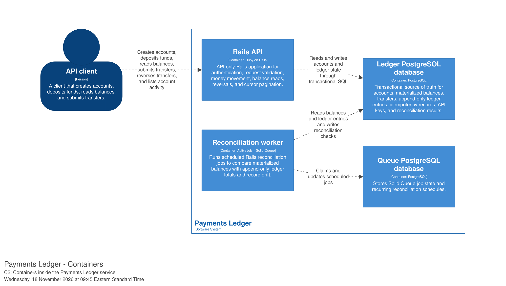

# Payments Ledger

Payments Ledger is a backend service for moving money between accounts safely.
It keeps account balances and a detailed transaction history consistent, even
when requests arrive at the same time or the same transfer is submitted twice.

The hardest problem was concurrent withdrawals. Multiple requests could otherwise
read the same balance and incorrectly approve transfers. PostgreSQL transactions,
row locking, and database constraints now ensure that invalid or duplicate
transfers are not committed.

The project focuses on backend correctness rather than visual breadth. It uses
integer-cent amounts and double-entry accounting: every completed transfer
creates one debit and one credit, so the ledger remains balanced.

This is a personal portfolio project, not a production payment system.

## Implemented

- Account creation, deposits, and balance reads
- Double-entry transfers with integer-cent amounts
- Database-enforced amount, account, and append-only ledger constraints
- Idempotency-key replay and payload-conflict handling for transfers
- Row locking and bounded retries for concurrent money movement
- Immutable transfer reversals represented by compensating entries
- Reconciliation drift checks through Solid Queue
- Hashed API-key authentication
- Cursor pagination for ledger entries and transfers
- Request, service, database, and PostgreSQL concurrency tests
- GitHub Actions checks for RSpec, RuboCop, Brakeman, and Bundler Audit

## Architecture

The API-only Rails application validates requests and executes money-movement
commands. PostgreSQL owns transactional state and enforces invariants. API-key
authentication, reconciliation, and background processing use Rails and
PostgreSQL-native components.

### C1: System context

### C2: Container view

The architecture is also maintained as Structurizr DSL in
[`architecture/workspace.dsl`](architecture/workspace.dsl), including the C1
system-context and C2 container views.

## Key design decisions

- Money is represented as integer cents instead of floating-point values.
- Transfers lock affected account rows and update the balance and ledger entries
  in one transaction.
- Database-level idempotency keys prevent concurrent requests from creating
  duplicate operations.
- Materialized balances are reconciled against append-only ledger entries.
- Corrections create new ledger entries instead of changing historical records.

## Testing

The test suite covers validation, authentication, atomic writes, constraints,
idempotency, reversals, reconciliation, and real concurrent PostgreSQL requests.

One concurrency test starts with a known balance and submits 100 withdrawals
whose combined amount exceeds that balance. The service must keep the account
from going negative, create only valid ledger entries, and preserve one
consistent balance.

See [development.md](development.md) for setup instructions, the data model,
test strategy, CI details, and scale considerations.

## Limitations

Payments Ledger intentionally does not implement account-level authorization,
rate limiting, audit logging, structured telemetry, or deployment automation.
These are scope boundaries rather than claims that the prototype is ready for
production payment traffic.

Future work includes webhooks, holds and authorizations, audit logging,
structured operational telemetry, and production deployment with measured load
testing.

For a more technical breakdown, see [development.md](development.md).
